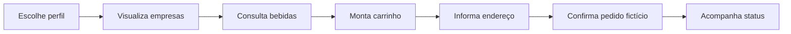
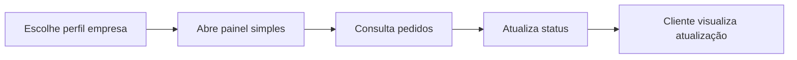
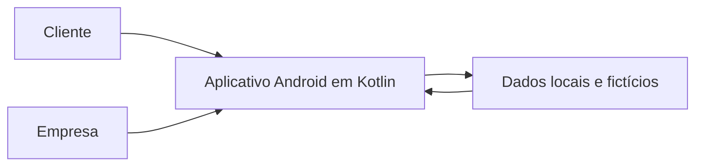

<div align="center">

# 🥤 BebidaJá

### Aplicativo Android acadêmico para aproximar clientes e empresas locais de bebidas


**UNIPÊ · Desenvolvimento Mobile · Goiana–PE e cidades próximas**

</div>

> [!IMPORTANT]
> Este repositório está na etapa inicial e ainda não contém o projeto Android executável. As funcionalidades descritas abaixo representam o escopo planejado, não funcionalidades já entregues. As instruções de execução serão completadas depois que a base Android for adicionada.

## Sumário

- [Sobre o projeto](#sobre-o-projeto)
- [Escopo do protótipo](#escopo-do-protótipo)
- [Jornadas principais](#jornadas-principais)
- [Arquitetura planejada](#arquitetura-planejada)
- [Tecnologias e execução](#tecnologias-e-execução)
- [Identidade visual](#identidade-visual)
- [Equipe](#equipe)
- [Status e licença](#status-e-licença)

## Sobre o projeto

O **BebidaJá** é um protótipo de aplicativo Android em Kotlin proposto para a disciplina **Desenvolvimento Mobile**, da **UNIPÊ**, com orientação do professor **Leandro Melo**. A ideia é reunir empresas locais, bebidas, preços e pedidos em uma experiência mobile simples.

O projeto busca facilitar a descoberta de estabelecimentos em **Goiana–PE e cidades próximas** e demonstrar dois lados da jornada: o cliente monta um pedido e a empresa consulta e atualiza esse pedido.

## Escopo do protótipo

| Área | O que o protótipo pretende demonstrar |
|---|---|
| **Cliente** | Escolher o perfil, visualizar empresas e bebidas, consultar detalhes e montar um carrinho. |
| **Pedido** | Informar um endereço de demonstração, confirmar um pedido fictício e visualizar seu status. |
| **Empresa** | Abrir um painel simples, consultar produtos e pedidos de exemplo e avançar o status de um pedido. |
| **Interação** | Usar busca ou categorias locais quando o fluxo principal estiver pronto. |

### O que fica fora desta versão

O protótipo não processa pagamentos, não implementa autenticação real e não depende de servidor remoto. Rastreamento GPS, roteirização automática, aplicativo de entregador, cupons avançados e marketplace financeiro ficam fora do prazo e do escopo acadêmico desta primeira entrega.

Os cadastros, endereços, pagamentos e pedidos são demonstrativos. A equipe deve usar dados fictícios na apresentação.

## Jornadas principais

### Cliente



### Empresa



## Arquitetura planejada

Para caber no prazo e no conhecimento atual da equipe, a demonstração começa com dados locais ou de exemplo. Não há backend obrigatório para mostrar os fluxos principais.



## Tecnologias e execução

- **Kotlin** — linguagem do aplicativo;
- **Android Studio** — ambiente de desenvolvimento;
- **Android SDK** — compilação e execução no emulador ou aparelho;
- **Material Design** — referência para componentes visuais Android;
- **Git e GitHub** — colaboração e versionamento.

### Preparação para rodar

O repositório ainda não possui os arquivos Gradle do aplicativo, então **não é possível executar o app neste momento**. Depois que a etapa-base for concluída:

1. Clone o repositório:

   ```bash
   git clone https://github.com/Pedro-hxm/App_Bebida_Ja.git
   cd App_Bebida_Ja
   ```

2. Abra no Android Studio a pasta que contém `settings.gradle` ou `settings.gradle.kts`.
3. Aguarde a sincronização do Gradle.
4. Selecione a configuração `app` e execute em um emulador ou aparelho Android.

Na configuração inicial, o grupo deve escolher **uma abordagem que já conheça** — por exemplo, Activities com layouts XML ou Jetpack Compose. A instrução exata de SDK/Gradle será adicionada quando essa escolha e a base do projeto estiverem no repositório.

## Identidade visual

O guia do projeto sugere uma interface limpa, legível e rápida:

- azul escuro `#17365D`, azul médio `#1F4E78`, azul claro `#D9EAF7` e branco;
- cards simples para empresas e produtos;
- preço e disponibilidade em destaque;
- categorias em chips e botões consistentes;
- navegação clara entre Início, Pesquisa, Pedidos e Perfil.

iFood, Zé Delivery e Rappi são referências para observar padrões de navegação e experiência. O BebidaJá deve manter identidade própria, sem copiar telas, marcas ou elementos proprietários.

## Equipe

As imagens são carregadas dos perfis públicos do GitHub. Clique no nome ou na foto para abrir o perfil.

<table>
  <tr>
    <td align="center" valign="top" width="50%">
      <a href="https://github.com/Pedro-hxm">
        <br>
        <strong>Pedro Henrique Paiva Barros</strong>
      </a><br>
      <sub>Líder · UI/UX, navegação e integração</sub><br>
      <a href="https://www.linkedin.com/in/pedro-henrique-198a81306/">LinkedIn</a>
    </td>
    <td align="center" valign="top" width="50%">
      <a href="https://github.com/Pedro-Brazz">
        <br>
        <strong>Pedro Antonio Braz da Silva</strong>
      </a><br>
      <sub>Carrinho, checkout demonstrativo e pedidos</sub><br>
      <a href="https://www.linkedin.com/in/pedro-braz-706540300/">LinkedIn</a>
    </td>
  </tr>
  <tr>
    <td align="center" valign="top" width="50%">
      <a href="https://github.com/LanNunez">
        <br>
        <strong>Arllan Leopoldino Nunes</strong>
      </a><br>
      <sub>Home, empresas, catálogo e busca</sub><br>
      <a href="https://www.linkedin.com/in/arllan-leopoldino-68799635b/">LinkedIn</a>
    </td>
    <td align="center" valign="top" width="50%">
      <a href="https://github.com/GuiCodeLabs">
        <br>
        <strong>Guilherme Cavalcante Beserra</strong>
      </a><br>
      <sub>Cadastros demonstrativos, validações e dados locais</sub><br>
      <a href="https://www.linkedin.com/in/guicodelabs/">LinkedIn</a>
    </td>
  </tr>
</table>

## Status e licença

| Item | Situação |
|---|---|
| Repositório e README | ✅ Disponíveis |
| Base Android Kotlin | ⏳ A configurar |
| Fluxos de cliente e empresa | 📋 Planejados |
| Dados de demonstração | 📋 A definir |
| Licença | A decidir em conjunto pelo grupo |

Este é um projeto acadêmico em desenvolvimento. O README deve ser atualizado conforme as funcionalidades forem implementadas e integradas à `main`.
