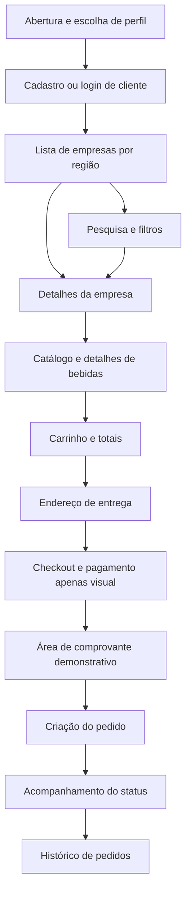
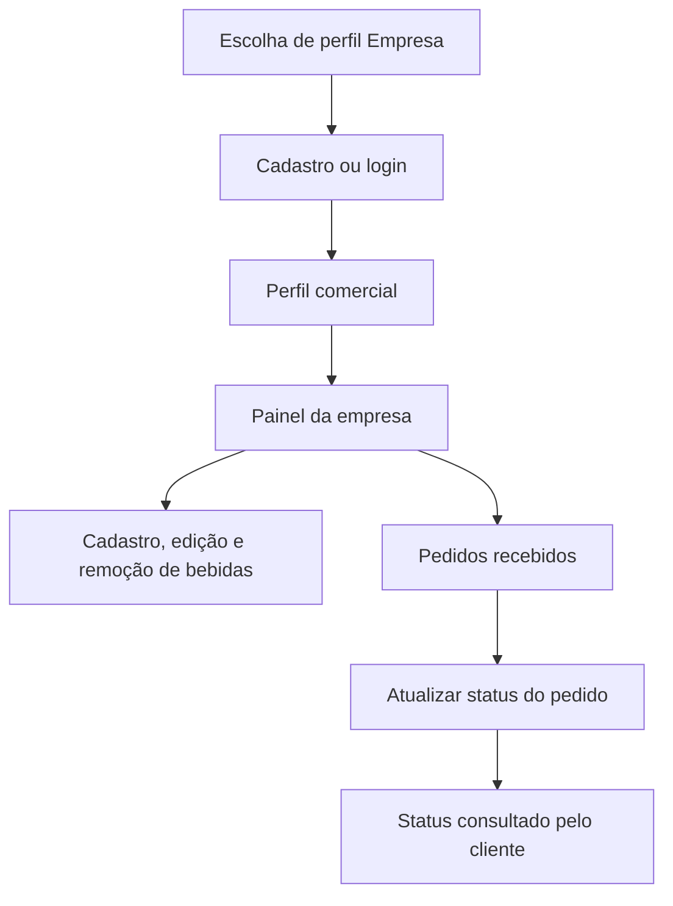

<div align="center">

# 🥤 BebidaJá

### Aplicativo Android de delivery de bebidas para Goiana–PE e cidades próximas


**UNIPÊ · Desenvolvimento Mobile · Professor Leandro Melo · Turno da tarde**

</div>

> [!IMPORTANT]
> **Fonte oficial do escopo:** `Plano_Projeto_BebidaJa (1).pdf`, documento apresentado ao professor. Este README descreve **todo o escopo planejado**, e não apenas uma demonstração reduzida. Funcionalidades aqui listadas **não devem ser interpretadas como já implementadas**. A execução e o progresso devem ser atualizados conforme o código for integrado.

## Sumário

- [Sobre o projeto](#sobre-o-projeto)
- [Público-alvo e perfis](#público-alvo-e-perfis)
- [Funcionalidades previstas](#funcionalidades-previstas)
- [Estrutura de telas](#estrutura-de-telas)
- [Jornadas de uso](#jornadas-de-uso)
- [Regras e limites da primeira versão](#regras-e-limites-da-primeira-versão)
- [Identidade visual e referências](#identidade-visual-e-referências)
- [Tecnologias](#tecnologias)
- [Como executar](#como-executar)
- [Equipe e responsabilidades](#equipe-e-responsabilidades)
- [Organização e acompanhamento](#organização-e-acompanhamento)

## Sobre o projeto

O **BebidaJá** é um projeto acadêmico de aplicativo Android nativo, desenvolvido em **Kotlin**, que busca conectar consumidores a **distribuidoras, depósitos de bebidas, conveniências, mercados e outros estabelecimentos locais** de Goiana–PE e cidades/distritos próximos.

A proposta é reunir informações das empresas, produtos, preços, disponibilidade e pedidos em um só lugar, reduzindo a dependência de contatos individuais por telefone ou aplicativos de mensagens. O aplicativo pretende facilitar a descoberta de empresas que entregam bebidas, oferecer clareza de preços e melhorar a organização das compras e dos pedidos, além de ampliar a visibilidade digital dos comércios participantes.

O objetivo acadêmico é construir um **protótipo Android funcional**, coerente com os conteúdos da disciplina Desenvolvimento Mobile e com o plano de projeto apresentado ao professor.

## Público-alvo e perfis

**Público-alvo:** moradores de Goiana–PE e arredores interessados em água, refrigerantes, sucos, energéticos, bebidas alcoólicas e outras bebidas; e estabelecimentos locais do segmento que desejam divulgar e gerenciar seus produtos.

| Perfil | Possibilidades previstas no plano |
|---|---|
| **Cliente** | Criar conta, fazer login, pesquisar empresas e bebidas, consultar produtos, montar carrinho, selecionar endereço, visualizar forma de pagamento, enviar/visualizar comprovante e acompanhar pedidos. |
| **Empresa** | Criar conta e cadastro comercial, informar dados do estabelecimento, cadastrar e manter bebidas, preços e disponibilidade, consultar pedidos recebidos e atualizar seus status. |

## Funcionalidades previstas

As **14 funcionalidades abaixo** reproduzem o escopo funcional do documento oficial, sem rebaixar cadastro, busca, gerenciamento de produtos, checkout, comprovante ou histórico a funcionalidades fora do projeto.

| Nº | Funcionalidade prevista |
|---|---|
| 01 | **Cadastro e login de clientes.** |
| 02 | **Cadastro e login de empresas.** |
| 03 | **Perfil da empresa:** nome, imagem, endereço, telefone, horário de funcionamento e área de entrega. |
| 04 | **Gerenciamento de bebidas pela empresa:** cadastrar, editar e remover produtos. |
| 05 | **Listagem de empresas** disponíveis por região. |
| 06 | **Catálogo de bebidas:** imagem, nome, volume, categoria, preço e disponibilidade. |
| 07 | **Pesquisa e filtros** por bebida, categoria e estabelecimento. |
| 08 | **Carrinho:** quantidades, remoção de itens, subtotal e total. |
| 09 | **Cadastro ou seleção de endereço** de entrega. |
| 10 | **Checkout visual**, com escolha de forma de pagamento (por exemplo, Pix, dinheiro ou cartão na entrega), **sem cobrança real**. |
| 11 | **Área de comprovante**, representando o envio e a visualização de um comprovante de pagamento. |
| 12 | **Criação e acompanhamento de pedidos**, com os estados **Recebido → Em preparação → Saiu para entrega → Entregue**. |
| 13 | **Histórico de pedidos** do cliente. |
| 14 | **Painel da empresa** para visualizar pedidos recebidos e gerenciar o catálogo. |

A implementação pode ser organizada em etapas, mas **a organização das sprints não altera o escopo originalmente proposto**. O documento [`CONTROLE_INTERNO.md`](./CONTROLE_INTERNO.md) detalha os responsáveis, critérios de aceite, dependências e entregas.

## Estrutura de telas

O plano apresentado prevê estas **20 telas/áreas**. Conforme a solução técnica adotada, algumas podem ser implementadas como telas independentes, abas ou etapas de um mesmo fluxo, desde que suas funções sejam contempladas.

| Nº | Tela / área | Nº | Tela / área |
|---|---|---|---|
| 01 | Splash / abertura | 11 | Carrinho |
| 02 | Escolha de perfil (Cliente ou Empresa) | 12 | Endereço de Entrega |
| 03 | Login | 13 | Checkout / pagamento visual |
| 04 | Cadastro de Cliente | 14 | Comprovante |
| 05 | Cadastro de Empresa | 15 | Acompanhamento do Pedido |
| 06 | Início / lista de estabelecimentos | 16 | Histórico de Pedidos |
| 07 | Pesquisa e filtros | 17 | Perfil do Cliente |
| 08 | Detalhes da Empresa | 18 | Painel da Empresa |
| 09 | Catálogo de Produtos | 19 | Cadastro/Edição de Produto |
| 10 | Detalhes do Produto | 20 | Pedidos Recebidos pela Empresa |

## Jornadas de uso

### Jornada do cliente



### Jornada da empresa



Os diagramas representam **fluxos propostos**, não comprovação de que todas as telas já estão prontas. O modo de registrar e compartilhar os dados deve ser definido e documentado durante o desenvolvimento.

## Regras e limites da primeira versão

- O aplicativo contempla **bebidas em geral, inclusive alcoólicas**, observando **controles e avisos adequados ao contexto de uso**.
- A escolha de Pix, dinheiro ou cartão integra um **checkout visual**: **não haverá transação financeira real** nesta primeira versão acadêmica.
- A área de comprovante deve **representar** envio/visualização; não comprova liquidação financeira.
- Empresas poderão criar seu próprio cadastro e **gerenciar produtos**, conforme o plano entregue.
- O atendimento previsto se concentra em **Goiana–PE e cidades próximas**.
- **Rastreamento GPS em tempo real, gateway real de pagamentos e logística/roteirização automática** ficam para versões futuras.
- Recursos de servidor, autenticação on-line e sincronização devem ser tratados conforme a escolha técnica do grupo. O plano não exige Firebase ou API na primeira versão, mas prevê essas alternativas para evolução futura.

## Identidade visual e referências

A identidade proposta é simples, moderna e confiável, com leitura rápida, informações objetivas e ações fáceis de localizar.

| Aplicação | Cor | Código |
|---|---|---|
| Cabeçalhos, identidade institucional | Azul escuro | `#17365D` |
| Botões e elementos de destaque | Azul médio | `#1F4E78` |
| Cards e fundos secundários | Azul claro | `#D9EAF7` |
| Fundo principal | Branco | `#FFFFFF` |
| Confirmação, disponibilidade e pedido concluído | Verde | Cor a definir na implementação |
| Promoções, alertas e indisponibilidade | Laranja/vermelho | Cores a definir na implementação |

**Diretrizes de interface:** navegação inferior com **Início, Pesquisa, Pedidos e Perfil**; cards para estabelecimentos e bebidas; categorias em chips; imagens proporcionais; preço e disponibilidade em destaque; acesso fácil ao carrinho; botões grandes e consistentes; status do pedido apresentados em etapas.

As categorias de referência incluem **Água, Refrigerante, Suco, Energético, Cerveja, Destilados e Outros**. Para estudar padrões de navegação, catálogo, compra de bebidas, busca e checkout, o grupo utiliza **iFood, Zé Delivery e Rappi** como referências de experiência — **sem copiar telas, marcas ou elementos proprietários**.

## Tecnologias

| Tecnologia | Papel no projeto |
|---|---|
| **Kotlin** | Linguagem principal do aplicativo Android nativo. |
| **Android Studio / Android SDK** | Desenvolvimento, compilação e execução do aplicativo. |
| **Material Design** | Referência para a interface e seus componentes. |
| **Jetpack Compose e Material 3** | Interface nativa escolhida para a base visual inicial. |
| **Room/SQLite** | **Opção** de persistência local para a fase acadêmica, não uma obrigação já definida. |
| **Firebase ou API própria** | **Possibilidades futuras**, previstas no plano, para autenticação e dados on-line. |
| **Git/GitHub** | Versionamento e colaboração entre os integrantes. |

> [!NOTE]
> O plano oficial define **o que o aplicativo deve oferecer**; ele não determina uma arquitetura obrigatória de backend. Qualquer escolha técnica concretizada deve ser registrada aqui, sem apagar funcionalidades previstas no escopo.

## Como executar

A base visual inicial usa Kotlin, Jetpack Compose e Material 3. Ela apresenta navegação e telas demonstrativas; cadastro, login, busca funcional, persistência e pedidos ainda não foram implementados.

> Requisitos: Android Studio, Android SDK Platform 37 e JDK 17 ou superior. Na primeira sincronização, o Gradle baixa a distribuição e as dependências.

1. Clone o repositório:

   ```bash
   git clone https://github.com/Pedro-hxm/App_Bebida_Ja.git
   cd App_Bebida_Ja
   ```

2. Abra no **Android Studio** a pasta do projeto que contém `settings.gradle` ou `settings.gradle.kts`.
3. Aguarde a sincronização do **Gradle**.
4. Selecione a configuração `app` e execute em um emulador ou aparelho Android compatível.
5. Se algum passo não funcionar, consulte as instruções atualizadas pela equipe após a configuração inicial.

Não publique `local.properties`, tokens, chaves de API, senhas ou dados sensíveis no repositório.

## Documentação técnica

Os documentos de arquitetura e o estado desta base estão em [docs/README.md](./docs/README.md).

## Equipe e responsabilidades

Responsabilidades conforme a divisão de tarefas do **plano entregue ao professor**.

<div align="center">
<table>
  <tr>
    <td align="center" valign="top" width="50%">
      <a href="https://github.com/Pedro-hxm"><br><strong>Pedro Henrique Paiva Barros</strong></a><br>
      <sub>Líder · UI/UX, navegação, perfil, acompanhamento, integração, testes e apresentação</sub><br>
      <a href="https://www.linkedin.com/in/pedro-henrique-198a81306/">LinkedIn</a>
    </td>
    <td align="center" valign="top" width="50%">
      <a href="https://github.com/GuiCodeLabs"><br><strong>Guilherme Cavalcante Beserra</strong></a><br>
      <sub>Cadastro e login de cliente/empresa, validações, modelos, persistência e integração</sub><br>
      <a href="https://www.linkedin.com/in/guicodelabs/">LinkedIn</a>
    </td>
  </tr>
  <tr>
    <td align="center" valign="top" width="50%">
      <a href="https://github.com/LanNunez"><br><strong>Arllan Leopoldino Nunes</strong></a><br>
      <sub>Home, empresas, detalhes, catálogo, categorias, pesquisa e filtros</sub><br>
      <a href="https://www.linkedin.com/in/arllan-leopoldino-68799635b/">LinkedIn</a>
    </td>
    <td align="center" valign="top" width="50%">
      <a href="https://github.com/Pedro-Brazz"><br><strong>Pedro Antonio Braz da Silva</strong></a><br>
      <sub>Carrinho, quantidades e totais, endereço, checkout visual, comprovante e histórico de pedidos</sub><br>
      <a href="https://www.linkedin.com/in/pedro-braz-706540300/">LinkedIn</a>
    </td>
  </tr>
</table>
</div>

## Organização e acompanhamento

A equipe deve usar o [`CONTROLE_INTERNO.md`](./CONTROLE_INTERNO.md) como **guia operacional compartilhado**, com:

- matriz completa de funcionalidades, critérios de aceite e responsáveis;
- distribuição das **Sprints 0 a 5**, seguindo `05_Demandas_Equipe_Sprints.pdf`;
- mapeamento das 20 telas, dependências, integração e testes;
- proposta de branches e checklist para a apresentação.

**Critério de resultado esperado:** um protótipo Android funcional em que o cliente localiza empresas, visualiza bebidas, monta pedidos e acompanha o status; e a empresa pode se cadastrar, administrar produtos e visualizar/atualizar pedidos. Os demais itens detalhados neste README também integram o planejamento oficial e devem ser acompanhados durante a execução.

**Documentos de referência:** `Plano_Projeto_BebidaJa (1).pdf` (**fonte oficial**); `04_Objetivos_Escopo_Regras.pdf`; `02_Guia_Visual_Cores_Layout.pdf`; `03_Referencias_de_Apps.pdf`; `05_Demandas_Equipe_Sprints.pdf`. Em caso de divergência sobre o escopo, prevalece o plano entregue ao professor.
