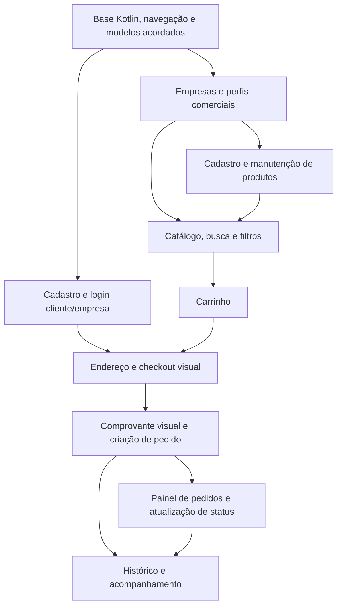

# BebidaJá — controle interno de escopo, responsabilidades e entregas

> **Documento de trabalho compartilhado da equipe.** Seu objetivo é transformar o projeto apresentado ao professor em tarefas verificáveis, **sem diminuir ou substituir o escopo acadêmico**. Pode ser mantido no repositório da equipe, desde que não contenha credenciais ou dados privados.

## 0. Regra principal: qual é o escopo verdadeiro?

**A referência principal e prevalecente é `Plano_Projeto_BebidaJa (1).pdf`, entregue ao professor Leandro Melo, da disciplina Desenvolvimento Mobile da UNIPÊ.**

- O plano oficial prevê **14 funcionalidades principais, 20 telas/áreas e dois perfis (cliente e empresa)**.
- Cadastro/login, gestão de produtos, pesquisa/filtros, checkout visual, comprovante, histórico e painel da empresa **fazem parte do escopo**.
- As tarefas podem ser implementadas por etapas, mas **não devem ser descartadas ou reclassificadas como opcionais apenas para caber em uma semana**.
- A área de comprovante é prevista no rol de funcionalidades; sua natureza é **visual/demonstrativa**, e o item 8 do plano admite uma tela de comprovante para representar a experiência.
- **Pagamento real, rastreamento GPS em tempo real e logística/roteirização automática** não fazem parte desta primeira versão.
- `05_Demandas_Equipe_Sprints.pdf`, `02_Guia_Visual_Cores_Layout.pdf`, `03_Referencias_de_Apps.pdf` e `04_Objetivos_Escopo_Regras.pdf` **detalham** o planejamento, mas não substituem o plano oficial.
- Modelos, branch names, critérios de aceite e acordos técnicos abaixo são **propostas operacionais para a equipe**, não exigências textuais adicionais do professor.

### Identificação

| Campo | Definição |
|---|---|
| Projeto | BebidaJá |
| Instituição / disciplina | UNIPÊ · Desenvolvimento Mobile · Turno da tarde |
| Professor | Leandro Melo |
| Plataforma / linguagem | Android nativo · Kotlin · Android Studio |
| Região prevista | Goiana–PE e cidades/distritos próximos |
| Líder | Pedro Henrique Paiva Barros |
| Integrantes | Guilherme Cavalcante Beserra; Arllan Leopoldino Nunes; Pedro Antonio Braz da Silva; Pedro Henrique Paiva Barros |

## 1. Objetivo, público e perfis

O BebidaJá pretende conectar consumidores a distribuidoras, depósitos, conveniências, mercados e outros estabelecimentos locais que trabalham com entrega de bebidas. Deve centralizar empresas, preços, catálogo, disponibilidade, carrinho, endereço, comprovante, pedidos e acompanhamento de status.

**Cliente:** cadastra-se e entra no aplicativo; encontra empresas e bebidas; pesquisa, filtra, seleciona endereço, escolhe visualmente pagamento, acessa comprovante e acompanha pedidos/histórico.

**Empresa:** cadastra-se e entra no aplicativo; informa nome, imagem, endereço, telefone, horário e área de entrega; mantém bebidas, preços e disponibilidade; consulta pedidos recebidos e atualiza seu status.

O catálogo abrange **água, refrigerantes, sucos, energéticos e bebidas alcoólicas, entre outras**. Para bebidas alcoólicas, o plano exige **controles e avisos adequados ao contexto de uso**; a implementação concreta deve ser definida pelo grupo e registrada, sem presumir que o PDF especificou um mecanismo particular.

## 2. Requisitos funcionais completos e critérios de aceite

Os itens **RF01–RF14** correspondem, na mesma ordem, às **14 funcionalidades principais** do plano. Os critérios são uma forma operacional de comprovar cada requisito, não uma mudança de escopo.

| ID | Funcionalidade do plano | Responsável principal / apoio | Critério verificável de aceite (proposta interna) |
|---|---|---|---|
| **RF01** | Cadastro e login de clientes | **Guilherme** · Pedro Henrique (navegação) | Fluxos de cadastro/login do cliente acessíveis; validações e entrada no perfil correspondente demonstráveis. |
| **RF02** | Cadastro e login de empresas | **Guilherme** · Pedro Henrique (navegação) | Fluxos de cadastro/login da empresa acessíveis; dados comerciais ligados ao perfil da empresa. |
| **RF03** | Perfil da empresa com nome, imagem, endereço, telefone, horário e área de entrega | **Guilherme** (dados/cadastro) · **Arllan** (detalhes/exibição) | Os seis campos estão representados no cadastro/perfil ou detalhes conforme o desenho das telas. |
| **RF04** | Cadastro, edição e remoção de bebidas pela empresa | **Arllan** (interface/catálogo) · **Guilherme** (modelos/persistência) | Empresa consegue incluir, alterar e remover produtos; mudanças aparecem no catálogo consultado. |
| **RF05** | Listagem de empresas disponíveis por região | **Arllan** | Tela inicial apresenta empresas e permite identificar a região/área atendida. |
| **RF06** | Catálogo com imagem, nome, volume, categoria, preço e disponibilidade | **Arllan** · Guilherme (dados) | Cada bebida mostra os seis atributos previstos, com detalhes acessíveis. |
| **RF07** | Pesquisa/filtros por bebida, categoria e estabelecimento | **Arllan** | Buscar ou filtrar por cada um dos três critérios modifica os resultados apresentados. |
| **RF08** | Carrinho com quantidade, remoção, subtotal e total | **Pedro Antonio** · Arllan (integração do produto) | Adicionar/remover/alterar quantidade recalcula subtotal e total corretamente. |
| **RF09** | Cadastro/seleção de endereço de entrega | **Pedro Antonio** · Guilherme (modelo, se necessário) | O cliente pode informar ou selecionar endereço no fluxo antes de confirmar o pedido. |
| **RF10** | Checkout visual com Pix, dinheiro ou cartão na entrega, sem pagamento real | **Pedro Antonio** | A forma de pagamento escolhida aparece no resumo; nenhuma transação real é executada. |
| **RF11** | Área de envio/visualização de comprovante | **Pedro Antonio** | Existe representação visual da ação de enviar/consultar comprovante, identificada como demonstração. |
| **RF12** | Criação de pedido e status Recebido, Em preparação, Saiu para entrega e Entregue | **Pedro Antonio** (criação) · **Pedro Henrique** (acompanhamento/status) · Guilherme (dados) | Pedido criado com itens/endereço; empresa muda status entre os quatro estados e cliente consegue ver o estado correspondente. |
| **RF13** | Histórico de pedidos do cliente | **Pedro Antonio** · Guilherme (dados) | O cliente encontra pedidos anteriores, com pelo menos informações de identificação, itens/valor e status. |
| **RF14** | Painel da empresa para pedidos e gerenciamento de catálogo | **Pedro Henrique** (navegação/status/integração) · **Arllan** (produtos) · Guilherme (dados) | Painel acessa pedidos recebidos e operações de catálogo, integrando os módulos correspondentes. |

**Regra de acompanhamento:** o quadro de tarefas pode estabelecer uma ordem de implementação, mas **todos os RF01–RF14 permanecem no backlog do projeto oficial**. Qualquer alteração de escopo deve ser discutida pela equipe e, quando apropriado, alinhada ao professor.

## 3. As 20 telas do plano e seus responsáveis

O plano descreve 20 telas/áreas. A divisão abaixo organiza os responsáveis pela **implementação e integração**, sem exigir que cada função seja uma Activity isolada.

| Nº | Tela / área oficial | Referência principal de implementação | Conferência |
|---|---|---|---|
| 01 | Splash / abertura | Pedro Henrique | [ ] |
| 02 | Escolha de perfil (Cliente ou Empresa) | Pedro Henrique · Guilherme | [ ] |
| 03 | Login | Guilherme · Pedro Henrique | [ ] |
| 04 | Cadastro de Cliente | Guilherme | [ ] |
| 05 | Cadastro de Empresa | Guilherme | [ ] |
| 06 | Início / lista de estabelecimentos | Arllan | [ ] |
| 07 | Pesquisa e filtros | Arllan | [ ] |
| 08 | Detalhes da Empresa | Arllan · Guilherme | [ ] |
| 09 | Catálogo de Produtos | Arllan | [ ] |
| 10 | Detalhes do Produto | Arllan | [ ] |
| 11 | Carrinho | Pedro Antonio | [ ] |
| 12 | Endereço de Entrega | Pedro Antonio | [ ] |
| 13 | Checkout / pagamento visual | Pedro Antonio | [ ] |
| 14 | Comprovante | Pedro Antonio | [ ] |
| 15 | Acompanhamento do Pedido | Pedro Henrique · Pedro Antonio | [ ] |
| 16 | Histórico de Pedidos | Pedro Antonio | [ ] |
| 17 | Perfil do Cliente | Pedro Henrique · Guilherme | [ ] |
| 18 | Painel da Empresa | Pedro Henrique · Arllan | [ ] |
| 19 | Cadastro/Edição de Produto | Arllan · Guilherme | [ ] |
| 20 | Pedidos Recebidos pela Empresa | Pedro Henrique · Pedro Antonio · Guilherme | [ ] |

> **Checklist inicial, não diagnóstico do repositório:** marque `[x]` apenas depois de verificar a tela/área no aplicativo integrado. Se duas áreas forem consolidadas numa mesma tela, registre a decisão e teste as duas funções.

## 4. Divisão oficial de responsabilidades

As responsabilidades da tabela a seguir seguem o **item 9 do plano apresentado ao professor**. O mapeamento por RF/tela apenas distribui atividades de integração entre esses responsáveis.

### Guilherme Cavalcante Beserra — autenticação e dados

- Cadastro e login de **cliente e empresa**.
- Validações de campos e fluxos de acesso.
- Modelos de dados e persistência escolhida pelo grupo.
- Integração de cadastro comercial, produtos e pedidos com os demais módulos.
- Apoio à equipe na manutenção da consistência dos dados.

### Arllan Leopoldino Nunes — Home, empresas e catálogo

- Tela inicial e listagem de empresas.
- Detalhes dos estabelecimentos.
- Catálogo de produtos, detalhes e categorias.
- Pesquisa e filtros por bebida, categoria e estabelecimento.
- Interface de manutenção de produtos da empresa, em conjunto com os modelos/persistência de Guilherme.
- Integração da opção **Adicionar ao carrinho** com o módulo de Pedro Antonio.

### Pedro Antonio Braz da Silva — carrinho e pedidos

- Carrinho com itens, quantidade, remoção, subtotal e total.
- Endereço de entrega.
- Checkout e **seleção visual da forma de pagamento**, sem cobrança real.
- Área visual de **envio/consulta de comprovante**.
- Criação de pedidos, histórico do cliente e integração do status com Pedro Henrique.

### Pedro Henrique Paiva Barros — líder, UI/UX, navegação e integração

- Padrões de UI, identidade visual e estrutura de navegação.
- Área de perfil e acompanhamento dos pedidos.
- Integração do painel da empresa, consulta de pedidos e atualização de status.
- Integração entre módulos, revisão de Pull Requests, testes finais.
- Coordenação da equipe, apresentação e entrega da versão final.

## 5. Organização por sprints — conforme `05_Demandas_Equipe_Sprints.pdf`

**Não existe duração fixa de uma semana estabelecida no plano oficial.** As Sprints 0 a 5 descrevem uma ordem de trabalho, sem eliminar entregas. Datas e duração devem ser combinadas com o calendário real da disciplina.

### Sprint 0 — Planejamento

- **Todos:** validar escopo integral, jornadas, identidade visual e estrutura do projeto.
- **Pedro Henrique:** organizar backlog, navegação, componentes e padrões.
- **Guilherme:** definir modelos de usuário/empresa e estratégia de persistência.
- **Arllan:** mapear Home, detalhes da empresa, catálogo e pesquisa.
- **Pedro Antonio:** mapear carrinho, checkout, comprovante e pedido.

**Resultado conferível:** mapa das 20 telas, RF01–RF14 distribuídos, tecnologia de UI escolhida e contratos básicos entre módulos acordados.

### Sprint 1 — Base e autenticação

- **Guilherme:** login/cadastro de cliente e empresa.
- **Pedro Henrique:** estrutura de navegação e componentes visuais.
- **Arllan:** estrutura da Home e cards de empresas.
- **Pedro Antonio:** modelos iniciais de carrinho e pedido.

**Resultado conferível:** aplicativo-base abre e navega entre perfis; cadastro e login em desenvolvimento/integrados; modelos compartilhados definidos.

### Sprint 2 — Empresas e catálogo

- **Arllan:** empresas, detalhes, produtos, categorias, busca e filtros.
- **Guilherme:** persistência e integração do cadastro da empresa.
- **Pedro Henrique:** revisão visual e integração dos fluxos.
- **Pedro Antonio:** preparar integração de produtos ao carrinho.

**Resultado conferível:** empresas com perfil comercial e catálogo exibidos; pesquisa/filtros e integração dos produtos planejadas/testadas.

### Sprint 3 — Carrinho e checkout

- **Pedro Antonio:** carrinho, quantidades, totais, endereço, pagamento visual e comprovante.
- **Guilherme:** persistência/modelos de pedidos.
- **Arllan:** ajustes no catálogo para adicionar ao carrinho.
- **Pedro Henrique:** navegação e integração da jornada do cliente.

**Resultado conferível:** cliente monta carrinho, informa endereço, escolhe pagamento visual, acessa comprovante e cria pedido sem cobrança real.

### Sprint 4 — Pedidos e empresa

- **Pedro Henrique:** acompanhamento/status de pedidos e integração do painel.
- **Pedro Antonio:** histórico de pedidos.
- **Guilherme:** dados dos pedidos e atualização.
- **Arllan:** painel de produtos da empresa e ajustes no catálogo (incluindo operações de cadastro/edição/remoção previstas no plano).

**Resultado conferível:** empresa consulta pedidos e gerencia produtos; altera status; cliente acompanha e consulta histórico.

### Sprint 5 — Qualidade e entrega

- **Todos:** testes integrados, correções e validação de **RF01–RF14**.
- **Pedro Henrique:** organizar apresentação, revisão visual e versão final.
- **Guilherme:** revisar cadastros, validações e dados.
- **Arllan:** revisar Home, perfil de empresa, catálogo, filtros e gerenciamento de produtos.
- **Pedro Antonio:** revisar carrinho, endereço, checkout visual, comprovante e pedidos/histórico.

**Resultado conferível:** aplicativo demonstrável no Android; fluxos cliente/empresa revisados; README e status real das tarefas atualizados.

## 6. Identidade visual e experiência

Conforme o plano e o guia visual:

| Uso | Identidade proposta |
|---|---|
| Cor institucional / cabeçalhos | Azul escuro `#17365D` |
| Botões, títulos e destaques | Azul médio `#1F4E78` |
| Cards, chips e fundos secundários | Azul claro `#D9EAF7` |
| Fundo principal | Branco `#FFFFFF` |
| Confirmação, disponibilidade e conclusão | Verde (tom a escolher pelo grupo) |
| Promoções, alertas e indisponibilidade | Laranja/vermelho (tons a escolher pelo grupo) |
| Navegação inferior | **Início · Pesquisa · Pedidos · Perfil** |
| Categorias de referência | **Água · Refrigerante · Suco · Energético · Cerveja · Destilados · Outros** |
| Interação | Cards, preços claros, carrinho acessível, botões de ação consistentes, status em etapas |

**Referências de UX:** iFood (empresa/catálogo/pedidos), Zé Delivery (bebidas e entrega) e Rappi (categorias, busca e checkout). Observar padrões; **não reproduzir marcas, telas ou elementos proprietários**.

**Atenção ao álcool:** a primeira versão inclui bebidas alcoólicas. Prever aviso e controles adequados ao contexto de uso, a serem definidos e revisados pelo grupo.

## 7. Regras de produto e limites técnicos

### O que deve ser preservado

1. **Dois perfis completos**: cliente e empresa, com cadastro e login.
2. **Cadastro e manutenção de produtos** pela empresa; preço e disponibilidade visíveis no catálogo.
3. **Busca e filtros** e listagem de empresas por região.
4. **Carrinho + endereço + checkout visual + comprovante** no caminho de compra.
5. **Criação de pedidos, quatro status, histórico e painel da empresa**.
6. **Interface Android/Kotlin** coerente com a proposta visual e com a região de atuação.

### O que o plano NÃO exige na primeira versão

- Processamento real de **Pix, cartão ou outros pagamentos**.
- **Gateway financeiro** de pagamento.
- **GPS em tempo real** ou rastreamento de entregadores.
- **Roteirização ou logística automática** de entregas.
- Obrigação de usar **Firebase ou API própria** desde já: são possibilidades futuras mencionadas no plano.

**Decisões em aberto, que não podem ser apresentadas como fatos consumados:** escolher **Activities/Fragments com XML ou Jetpack Compose**, definir SDK/versão Android e decidir a estratégia de persistência. O plano cita **Room/SQLite como opção** local. Dados de demonstração podem auxiliar a integração, mas não substituem a existência das funcionalidades previstas.

## 8. Contratos de dados sugeridos para integração (proposta técnica)

> Esta seção organiza o desenvolvimento; **não é um diagrama de classes obrigatório no PDF**. A equipe pode ajustar nomes e tipos em conjunto, preservando os campos necessários para o escopo.

| Modelo sugerido | Campos mínimos sugeridos |
|---|---|
| `Cliente` | `id`, `nome`, dados de acesso, endereço(s) associado(s) |
| `Empresa` | `id`, `nome`, `imagem`, `endereco`, `telefone`, `horario`, `areaEntrega`, dados de acesso |
| `Produto` | `id`, `empresaId`, `nome`, `imagem`, `volume`, `categoria`, `preco`, `disponivel` |
| `ItemCarrinho` | `produtoId`, `quantidade`, `precoUnitario` |
| `EnderecoEntrega` | Identificador, dados do endereço e referência ao cliente, se aplicável |
| `Pedido` | `id`, cliente/empresa, itens, endereço, subtotal/total, forma de pagamento visual, comprovante visual, `status`, data |
| `StatusPedido` | `RECEBIDO`, `EM_PREPARACAO`, `SAIU_PARA_ENTREGA`, `ENTREGUE` |

**Acordos que precisam ser tomados antes de integrar:** quem mantém o carrinho, como passar um produto do catálogo, como criar e recuperar pedidos, como atualizar o estado visto pelos dois perfis, qual persistência utilizar e como representar a área de comprovante sem qualquer transação financeira.

Não armazenar senhas reais em texto aberto, credenciais ou chaves no Git. Para a apresentação, preferir dados de teste e deixar visível quando um fluxo de pagamento/comprovante for simulado.

## 9. Dependências de implementação e integração

As equipes podem criar telas em paralelo com dados de teste. A dependência crítica é o **contrato para integração final**, não a necessidade de esperar toda a sprint anterior terminar.

## 10. Proposta de branches e colaboração no GitHub

Este fluxo de Git **é uma recomendação interna**, preservando as duas branches por pessoa do documento de controle anterior. Ele pode ser alterado em comum acordo; **não é exigência do plano do professor**.

- `main`: versão revisada e estável, destinada à demonstração.
- `develop`: integração contínua do trabalho em desenvolvimento.
- `feat/...`: branches por responsabilidade, criadas a partir de `develop`, integradas por Pull Request.

| Pessoa | Branch sugerida | Abrangência completa |
|---|---|---|
| Pedro Henrique | `feat/pedro-henrique-navegacao-ui` | Splash, escolha de perfil, navegação, perfil do cliente, componentes e identidade visual. |
| Pedro Henrique | `feat/pedro-henrique-painel-status` | Painel da empresa, pedidos recebidos, acompanhamento, quatro status e integração dos módulos. |
| Guilherme | `feat/guilherme-modelos-dados-locais` | Modelos de cliente/empresa/produto/pedido, persistência adotada, dados compartilhados e validações de modelo. |
| Guilherme | `feat/guilherme-cadastro-perfis` | Login e cadastro de cliente/empresa; perfil comercial completo e integração dos dados. |
| Arllan | `feat/arllan-home-empresas` | Home, empresas por região, cards e detalhes completos do estabelecimento. |
| Arllan | `feat/arllan-catalogo-busca` | Catálogo, detalhe, categorias, filtros e operações de criar/editar/excluir produtos pelo painel da empresa. |
| Pedro Antonio | `feat/pedro-antonio-carrinho-checkout` | Carrinho, totais, endereço, escolha visual de pagamento e área de comprovante. |
| Pedro Antonio | `feat/pedro-antonio-pedidos-historico` | Criação e histórico de pedidos, integração com acompanhamento/status. |

### Fluxo sugerido de trabalho

1. Combinar nomes de telas, contratos de dados, abordagem de UI e organização de arquivos.
2. Preparar `main` com base executável; criar `develop` e branches de trabalho a partir dela.
3. Fazer commits pequenos; abrir Pull Requests para `develop` com resumo e evidência do fluxo testado.
4. Revisar dependências compartilhadas com quem consome os dados antes de alterar modelos e rotas.
5. Integrar e testar diariamente, ou a cada entrega significativa, evitando conflitos em arquivos compartilhados.
6. Quando **RF01–RF14** estiverem avaliados e a demonstração estiver estável, integrar `develop` em `main`.
7. Atualizar README e checklist a cada entrega; não marcar funcionalidade como pronta só porque a tela foi desenhada.

## 11. Checklist de validação funcional

Marcar apenas após testar no aplicativo integrado (emulador ou dispositivo).

### Cliente

- [ ] Consegue acessar o app e escolher o perfil **Cliente**.
- [ ] Consegue realizar **cadastro e login**.
- [ ] Visualiza empresas da região e seus dados básicos/comerciais.
- [ ] Pesquisa bebidas/estabelecimentos e utiliza filtros por categoria.
- [ ] Entra nos detalhes da empresa e visualiza catálogo (imagem, nome, volume, categoria, preço e disponibilidade).
- [ ] Adiciona bebidas ao carrinho, altera quantidades e remove itens.
- [ ] Vê **subtotal e total corretos**.
- [ ] Cadastra ou escolhe um endereço de entrega.
- [ ] Visualiza e escolhe forma de pagamento (Pix/dinheiro/cartão na entrega), **sem transação real**.
- [ ] Acessa área de **envio/visualização de comprovante demonstrativo**.
- [ ] Confirma um pedido com itens, endereço e dados coerentes.
- [ ] Consulta o status e seu **histórico de pedidos**.

### Empresa

- [ ] Consegue escolher perfil **Empresa**, cadastrar-se e fazer login.
- [ ] Cadastra/visualiza nome, imagem, endereço, telefone, horário e área de entrega.
- [ ] Consegue cadastrar bebida com imagem, nome, volume, categoria, preço e disponibilidade.
- [ ] Consegue **editar e remover** bebidas e ver os efeitos no catálogo.
- [ ] Visualiza pedidos recebidos no painel.
- [ ] Avança um pedido entre **Recebido**, **Em preparação**, **Saiu para entrega** e **Entregue**.
- [ ] Atualização do pedido é apresentada de forma consistente no acompanhamento do cliente.

### Qualidade e limites

- [ ] App abre e navega no Android escolhido pelo grupo.
- [ ] Paleta, cards, botões e navegação são coerentes entre as telas.
- [ ] Todos os campos essenciais e preços são legíveis.
- [ ] Há **avisos/controles adequados** para bebidas alcoólicas, conforme decisões documentadas da equipe.
- [ ] **Nenhum pagamento real** é solicitado ou executado.
- [ ] Nenhum recurso excluído (GPS/roteirização automática/gateway real) é anunciado como pronto.
- [ ] Os 14 RFs e as 20 áreas foram conferidos; as eventuais consolidações de tela estão documentadas.
- [ ] Instruções do README condizem com a versão que o grupo realmente consegue executar.

## 12. Fluxo sugerido de demonstração ao professor

1. Abrir o aplicativo e mostrar os dois perfis.
2. **Cliente:** cadastro/login, empresas por região, pesquisa e filtros, detalhes da empresa e catálogo.
3. Adicionar bebidas, mudar quantidades, mostrar cálculo do carrinho e informar endereço.
4. Exibir checkout com pagamento **somente visual**, a área demonstrativa de comprovante e criar o pedido.
5. **Empresa:** cadastro/login, perfil comercial e painel; cadastrar, editar e remover um produto.
6. Abrir pedidos recebidos e avançar o pedido pelas quatro etapas de status.
7. Voltar ao cliente para mostrar acompanhamento e histórico.
8. Explicar limites reais da versão e tecnologias escolhidas, sem afirmar funcionamento de serviços não implementados.

## 13. Modelo de acompanhamento do backlog

Use um quadro único (GitHub Projects, Trello ou outro escolhido pelo grupo). Sugestão de campos: **ID RF / tela / sprint / responsável / status / branch ou PR / bloqueio / evidência de teste**. Atualize o andamento conforme o código; não pré-marque atividades como concluídas.

| Grupo de tarefas | Sprint de referência | Estado inicial do acompanhamento |
|---|---|---|
| Base, UI e modelos | Sprints 0–1 | A verificar com a equipe |
| Cadastro e login cliente/empresa | Sprint 1 | A verificar com a equipe |
| Empresas, perfil comercial, catálogo e filtros | Sprint 2 | A verificar com a equipe |
| Carrinho, endereço, checkout, comprovante e criação de pedido | Sprint 3 | A verificar com a equipe |
| Histórico, status, painel e manutenção de produtos | Sprint 4 | A verificar com a equipe |
| Testes integrados e apresentação | Sprint 5 | A verificar com a equipe |

### Critério de pronto do projeto

O projeto está pronto para a entrega pretendida quando o **resultado esperado do plano oficial** for demonstrado: cliente localiza empresas, visualiza bebidas, monta e acompanha pedidos; empresa cadastra-se, mantém produtos e visualiza/atualiza pedidos. Além disso, o grupo deve **conferir cada uma das 14 funcionalidades previstas**, inclusive cadastro/login, filtros, checkout e comprovante visuais e histórico, documentando com transparência qualquer diferença entre planejamento e implementação.

---

**Regra de referência para futuras decisões:** o escopo do BebidaJá é o do **`Plano_Projeto_BebidaJa (1).pdf`**. Nenhum resumo, README, backlog, divisão de sprint ou proposta de prazo deve substituí-lo ou restringi-lo sem uma decisão expressa da equipe e alinhamento acadêmico quando necessário.
